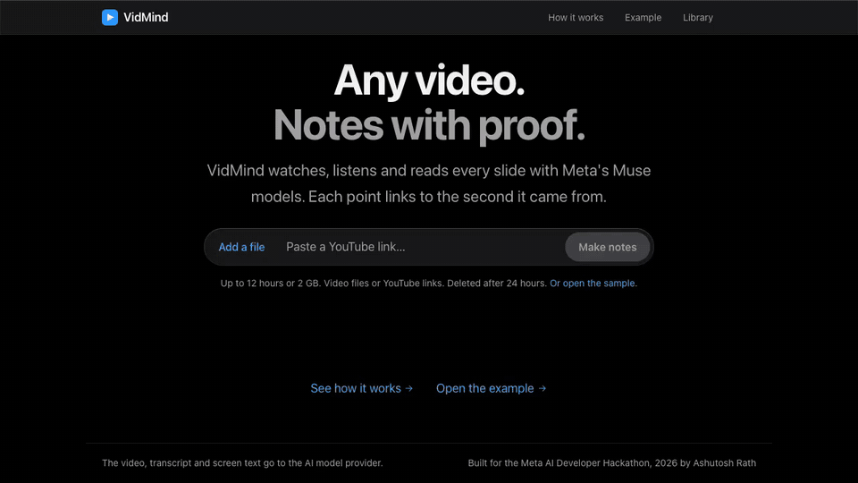
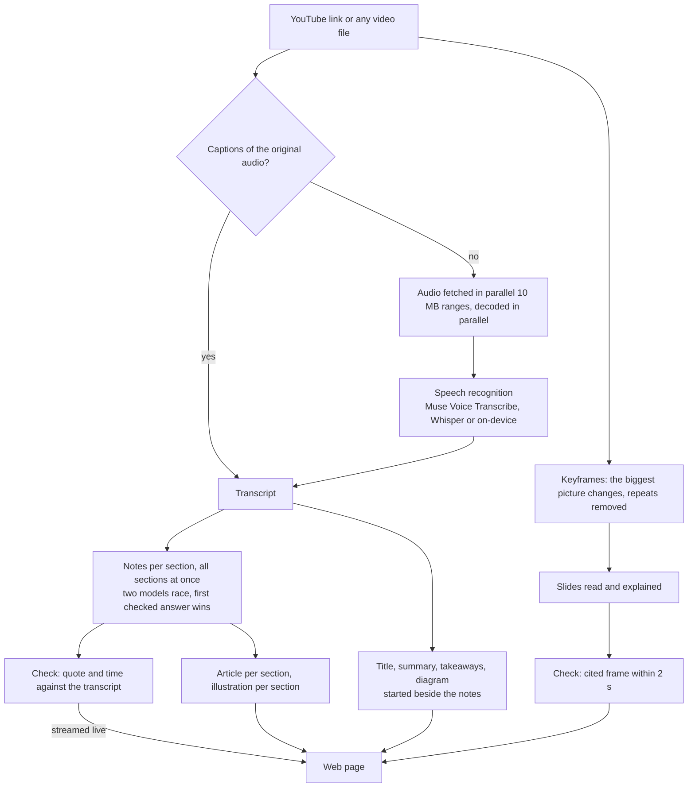

<div align="center">

# VidMind

### Any video. Notes with proof.

**Turn a 2-hour talk into a readable, checked article in about a minute.<br>Every point links to the exact second of the video it came from.**

[](LICENSE)
[](https://github.com/ashutoshrath1/vidmind/actions/workflows/install.yml)
[](#)



<sub>20 seconds, real app. <a href="docs/media/demo.mp4">Watch it as MP4</a>.</sub>

</div>

---

## Why VidMind

AI summaries of videos are fast, but you can't tell which parts are true. VidMind writes the notes **and proves
them**: every sentence carries a ✓ time link, hovering it shows the words or the slide it rests on, and clicking
it plays that second. Anything the video doesn't support is removed before you see it, and listed with the reason.

| | |
|---|---|
| ⚡ **Fast** | A 10-minute YouTube talk to all checked notes in **4.2–5.1 s**. A 2-hour talk: first note in **13–14 s**, all ~440 notes in **1 min 11–14 s**. |
| ✓ **Checked** | Each quote must match the transcript within 5 s of the time it cites; each screen citation must be a real keyframe within 2 s. |
| 🖼 **Reads the screen** | Slides, code and diagrams are read and explained, so facts only shown on screen make it into the notes. |
| 📝 **Yours** | One click copies a clean Markdown article. Bring any AI: Muse, OpenAI, Claude, free Groq / NVIDIA / OpenRouter, or fully offline with Ollama. |

## Install in one command

**macOS and Linux**

```bash
curl -fsSL https://raw.githubusercontent.com/ashutoshrath1/vidmind/main/install.sh | bash
```

**Windows** (PowerShell)

```powershell
irm https://raw.githubusercontent.com/ashutoshrath1/vidmind/main/install.ps1 | iex
```

The installer sets up everything that's missing (git, ffmpeg, Node 22, Python 3.12 via uv), builds VidMind in
`~/vidmind`, then **asks which AI to use** and takes your key (typed hidden, saved only in `~/vidmind/.env`).
Then start it:

```bash
vidmind          # opens http://localhost:3000
```

Paste a YouTube link or drop any video file. Run the installer again any time to update or switch AI.

## Choose your AI

Pick one in the installer, or edit `~/vidmind/.env` (every block is in [`.env.example`](.env.example)) and restart.

| Provider | Cost | Get a key | What you get | Tested live |
|---|---|---|---|---|
| **Meta Muse** (default) | paid | [dev.meta.ai](https://dev.meta.ai) → API keys | Everything: notes, speech, slide reading, illustrations, summary card | ✅ every role |
| **OpenAI** | paid | [platform.openai.com/api-keys](https://platform.openai.com/api-keys) | Notes, slide reading, Whisper speech, illustrations | wired, not run |
| **Anthropic** (Claude) | paid | [console.anthropic.com](https://console.anthropic.com/settings/keys) → API keys | Notes, slide reading; speech on your machine | wired, not run |
| **Groq** | **free tier** | [console.groq.com/keys](https://console.groq.com/keys) | Notes, very fast; speech on your machine | ✅ notes |
| **NVIDIA** | **free tier** | [build.nvidia.com](https://build.nvidia.com) → any model → *Get API Key* | Notes, slide reading | ✅ notes |
| **OpenRouter** | **free models** | [openrouter.ai/keys](https://openrouter.ai/keys) | Notes from hundreds of models (ids ending `:free` cost nothing) | wired, not run |
| **xAI Grok** | paid | [console.x.ai](https://console.x.ai) | Notes | wired, not run |
| **Ollama** | **free, private** | none: runs on your computer | Notes; speech and slide reading on your machine. Nothing leaves it | ✅ 16 GB MacBook Air |

<details>
<summary><b>Set a key by hand</b></summary>

Open `~/vidmind/.env`, uncomment your provider's block, paste the key, save, and run `vidmind` again. For example, Groq:

```bash
GROQ_API_KEY=gsk_...
LLM_MODELS=groq:openai/gpt-oss-120b,groq:openai/gpt-oss-20b
IMAGE_MODEL=
SEGMENT_MODEL=
SPEECH_MODEL=
READER_MODEL=
LLM_VISION_MODELS=
```

The empty lines switch off the Muse-only parts so nothing waits on them. Your `.env` is git-ignored; never commit it.

</details>

### Run fully offline with Ollama

Choose **8) Ollama** in the installer: it installs [Ollama](https://ollama.com), starts it and downloads
`qwen2.5:3b` (1.9 GB, once). That size is chosen for laptops: on a **16 GB MacBook Air** a 1-minute video had its
first checked section in **7.8 s** and was finished in **50 s**, with speech recognised by Parakeet and slides read
by Apple Vision, all on the machine. A 3B model writes the notes and articles but often no takeaways; with 32 GB or
more, try a bigger one:

```bash
ollama pull qwen2.5:7b && sed -i.bak 's/ollama:qwen2.5:3b/ollama:qwen2.5:7b/' ~/vidmind/.env
```

Free the disk space when you're done with a model: `ollama rm qwen2.5:3b` (the uninstaller offers this too).

## Uninstall

**macOS and Linux**

```bash
curl -fsSL https://raw.githubusercontent.com/ashutoshrath1/vidmind/main/uninstall.sh | bash
```

**Windows** (PowerShell)

```powershell
irm https://raw.githubusercontent.com/ashutoshrath1/vidmind/main/uninstall.ps1 | iex
```

This removes `~/vidmind` (the app, your notes and settings) and the `vidmind` command, and asks before deleting the
Ollama model. Shared tools (git, ffmpeg, Node, uv, Ollama) stay, since other apps may use them.

---

## How it works



Media processing is open source: ffmpeg, PyAV, yt-dlp, Pillow. AI calls go to the provider you chose.

### How every note is checked

1. **Quotes.** A note's quote must fuzzy-match the transcript (60% word match) within 5 s of the time it cites. A
   close but not exact quote (45% or more) is replaced by the transcript's actual words.
2. **Frames.** A note that cites the screen must point at a real keyframe within ±2 s.
3. **Repair.** If fewer than half of a section's notes pass, the model gets one repair round with the problems listed.
4. **Drop.** Notes that still fail are never shown as checked; they are removed and listed with the reason.

The rules live in [`api/src/vidmind/schema.py`](api/src/vidmind/schema.py) and [`pipeline.py`](api/src/vidmind/pipeline.py).

### Measured speed

On an M2 MacBook Air, warm server, Meta Muse:

| Video | First checked note | All checked notes |
|---|---|---|
| 10-minute YouTube talk with captions | – | **4.2–5.1 s** (4 runs) |
| 10-minute video without captions (speech recognition) | 4.0–6.5 s | 9.0–9.4 s |
| Karpathy's 2-hour "Let's build GPT" (2 runs) | **13–14 s** | **1 min 11–14 s** (439–440 notes) |

What makes it fast: captions before speech recognition; audio downloaded as parallel 10 MB ranges (42 MB in 1.6 s
where streaming took 11+ minutes); a keyframe-only scene scan (0.4 s instead of 6.2 s); every section written at
once with two models racing; title and takeaways started beside the notes; notes streamed to the page as they are
checked.

---

## For developers

<details>
<summary><b>Run from source</b></summary>

Requirements: Python 3.12 + [uv](https://docs.astral.sh/uv/), Node 20+, ffmpeg.

```bash
git clone https://github.com/ashutoshrath1/vidmind && cd vidmind
cp .env.example .env                                               # add a key (see Choose your AI)
cd api && uv run --env-file ../.env uvicorn vidmind.main:app --port 8000 --reload   # API
cd web && npm install && npm run dev                                                # web, second terminal
```

Open http://localhost:3000. `/jobs/sample` is a precomputed run of the 2-hour Karpathy talk.

</details>

<details>
<summary><b>Tests</b></summary>

```bash
cd api && uv run pytest                                          # API, pipeline, checks (models stubbed)
cd web && npm test                                               # pure functions in web/lib
cd scripts/eval_demo && npx playwright test -c e2e.config.ts     # end to end, against the running app
```

The installers are tested on fresh macOS, Ubuntu and Windows machines on every change
([install workflow](.github/workflows/install.yml)).

</details>

<details>
<summary><b>Models reference: every role is a setting</b></summary>

A model is written `provider:model`. Built-in providers: `muse`, `openai`, `anthropic`, `openrouter`, `groq`,
`nvidia`, `xai`, `ollama`, `apple`. Anything a provider has no key for is skipped, never an error.

| Variable | Role | Default | Must support |
|---|---|---|---|
| `LLM_MODELS` | Notes, article, takeaways | `muse:muse-spark-1.2,muse:muse-spark-1.3` | Chat completions, streaming, JSON replies |
| `LLM_VISION_MODELS` | Which of those also get keyframe images | `muse:muse-spark-1.3` | Image input in chat |
| `READER_MODEL` | Reads text on keyframes | `muse:muse-spark-1.3` | Image input. Empty: on-device OCR |
| `IMAGE_MODEL` | Illustrations, summary card | `muse:muse-image-1.0` | `images.generate` (base64). Empty: none |
| `SEGMENT_MODEL` | Finds diagrams for enlarged crops | `muse:sam-3.1` | Muse adapter only. Empty: no crops |
| `SPEECH_MODEL` | Speech when a video has no captions | `muse:muse-voice-transcribe-1.0` | Muse ASR or `/audio/transcriptions` (e.g. `openai:whisper-1`). Empty: on-device `ASR_ENGINE` |

Any other OpenAI-compatible server, with no code change:

```bash
PROVIDER_TOGETHER_BASE_URL=https://api.together.xyz/v1
PROVIDER_TOGETHER_API_KEY=...
LLM_MODELS=together:meta-llama/Llama-3.3-70B-Instruct-Turbo
```

</details>

<details>
<summary><b>HTTP API</b></summary>

| Method | Path | |
|---|---|---|
| GET | `/health` | liveness |
| POST | `/jobs` | multipart `file`; returns `{id, reused}` |
| POST | `/jobs/from-url` | JSON `{url, rights_confirmed}`; returns `{id, title, reused}` |
| GET | `/jobs/{id}` | `{status, error, sections_done, sections_total}` |
| GET | `/jobs/{id}/events` | status and every step as server-sent events until the job is complete |
| GET | `/jobs/{id}/result` | the result JSON; partial as soon as one section is done |
| GET | `/jobs/{id}/video`, `/jobs/{id}/frames/{name}` | media |
| DELETE | `/jobs/{id}` | removes the job's files |

</details>

### Known limits

- Links: YouTube only. Any other video (a Teams, Zoom or Meet recording) works as a file.
- YouTube sometimes refuses caption requests after many runs (HTTP 429); the job then uses speech recognition.
- Speed numbers come from one laptop. Jobs are deleted after 24 hours. The video, transcript and screen text go to
  the AI provider you chose (none, with Ollama).

## Contributing

Issues and pull requests are welcome. `main` is protected: changes land through a pull request reviewed by the
maintainer.

## License

[MIT](LICENSE) © 2026 Ashutosh Rath. Built for the Meta AI Developer Hackathon, 2026.
