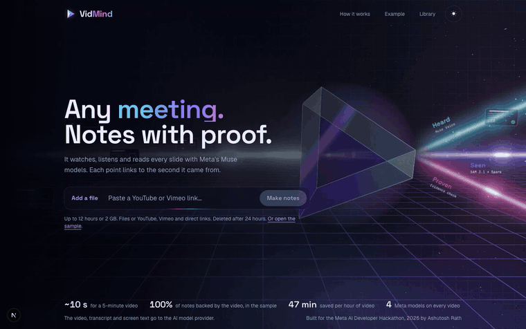
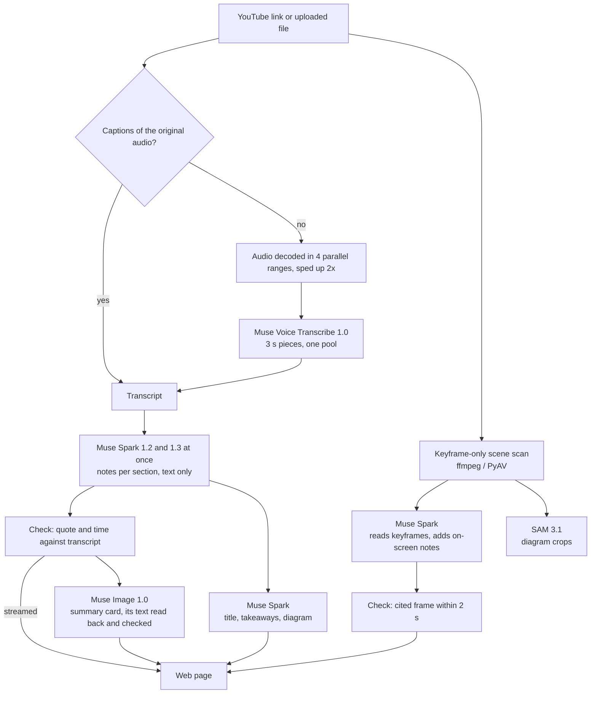

# VidMind

**Paste a video link and get notes in about 5 seconds. Each note is checked against the second of the video it came from.**



Live demo: (link to add)

Built for the Meta AI Developer Hackathon, 2026.

## What it does

- **Notes you can check.** A blog-style article where every point has a ✓ time link that plays that second. Hover
  it to see the words that were quoted. Notes the video does not support are removed and listed at the end
  ("Removed: N claims").
- **On screen.** Goes through the video slide by slide: what the notes say, what was said, and the text on screen.
- **How it was made.** For this run: time to the first note, time to all notes, % proven, the dropped notes with
  reasons, every step, and a chart.

## Architecture



All model calls go to Meta. Media processing is open source: ffmpeg, PyAV, yt-dlp.

## Benchmarks

Measured on one 10-minute English talk on an M2 MacBook Air, warm server.

| Route | Video length | First notes | All checked notes | Runs | Setup |
|---|---|---|---|---|---|
| YouTube link with captions | 10 min | – | 4.2-5.1 s (3 of 4 under 5 s) | 4 | M2 MacBook Air, warm server |
| Any video, no captions (Muse speech recognition) | 10 min | 4.0-6.5 s | 9.0-9.4 s | 6 / 3 | M2 MacBook Air, warm server |

Before the speed work, the YouTube route took 16.9 s.

## How every note is checked

1. **Quotes.** A note's quote must fuzzy-match the transcript (60% word match) within 5 s of the time it cites.
   A quote that is close but not exact (45% or more) is replaced by the transcript's actual words.
2. **Frames.** A note that cites the screen must point at a real keyframe within ±2 s.
3. **Repair.** If fewer than half of a section's notes pass, Spark gets one repair round with the problems listed.
4. **Drop.** Notes that still fail are never shown as checked. They are removed and listed with the reason.

The rules live in `api/src/vidmind/schema.py` (`ground`, `snap_quote`) and `api/src/vidmind/pipeline.py`.

## Why it's fast

All measured on the same talk:

- **Captions first.** YouTube's own captions of the original audio track (we were transcribing an AI dub before
  this was fixed).
- **Keyframe-only scene scan:** 0.36-0.48 s instead of 6.22 s decoding every frame.
- **Audio decode in 4 parallel ranges:** 0.31 s instead of 0.81 s.
- **Muse Voice Transcribe at 2x speed.** Word error 4.5-5.0% vs 5.1% at 1x. At 2.5x it was 7.4-7.7% and at 3x
  17-19%, so 2x stays.
- **3 s pieces in one pool.** Muse speech recognition is limited by throughput (about 4 s per 10 minutes however
  many pieces run at once).
- **Two models at once.** Each section goes to Spark 1.2 and 1.3 together; the first checked answer wins.
- **Streaming.** Notes reach the page as they are written, each one checked first.
- **Text-only notes.** Images add 0.6 s per call. One on-screen pass then reads the keyframes and adds checked
  on-screen notes.

What we benchmarked: 11 audio methods, 12 keyframe methods, 12+ speech engines. Muse Voice Transcribe took 4.8 s
(3.9% word error). Groq Whisper turbo took 1.1 s but is not a Meta model, so it is not used. Local whisper.cpp,
mlx-whisper, faster-whisper, Parakeet and Moonshine took 6.4-110 s.

## Use other models

VidMind is shown with Meta Muse, and every model is a setting. Nothing is hardcoded to Muse except the defaults:
set the variables below in `.env` (see `.env.example`). A model is written `provider:model`.

| Variable | Role | Default | Must support |
|---|---|---|---|
| `LLM_MODELS` | Notes, article, takeaways, answers | `muse:muse-spark-1.2,muse:muse-spark-1.3` | Chat completions, streaming, JSON replies |
| `LLM_VISION_MODELS` | Which of those also get keyframe images | `muse:muse-spark-1.3` | Image input in chat |
| `READER_MODEL` | Reads text on keyframes | `muse:muse-spark-1.3` | Image input in chat. Empty or unkeyed: local OCR |
| `IMAGE_MODEL` | Chapter illustrations, summary card | `muse:muse-image-1.0` | `images.generate` returning base64. Empty or unkeyed: no illustrations or card |
| `SEGMENT_MODEL` | Finds diagrams for enlarged crops | `muse:sam-3.1` | Only the Muse adapter exists. Empty or unkeyed: no crops |
| `SPEECH_MODEL` | Speech recognition when a video has no captions | `muse:muse-voice-transcribe-1.0` | Muse ASR, or `/audio/transcriptions` with `verbose_json` segments (e.g. `openai:whisper-1`). Else local `ASR_ENGINE` |

Built-in providers: `muse` (`MODEL_API_KEY`), `groq`, `nvidia`, `apple`. To add one, no code change:

```bash
PROVIDER_TOGETHER_BASE_URL=https://api.together.xyz/v1
PROVIDER_TOGETHER_API_KEY=...
LLM_MODELS=together:meta-llama/Llama-3.3-70B-Instruct-Turbo
```

Per-provider traits (`PROVIDER_<NAME>_EFFORT`, `_MAX_IN_FLIGHT`, `_HEDGE_S`, `_KIND`) and the speed settings tuned for
Muse (`ASR_SPEED`, `ASR_CHUNK_S`, `IMAGES_AT_ONCE`, ...) are in `.env.example`. Another provider's image, speech or
segmentation request shape is one small adapter in `synthesize.py` / `transcribe.py`, chosen by the provider's kind.

What is tested: the full configuration path with a fake provider (no Muse URL or model is used; unkeyed roles are
skipped), and the OpenAI-style speech request against a stub. What has run live: Muse for every role, plus Groq and
NVIDIA for notes. Other providers are untested; their output still goes through the same evidence checks.

## Run it locally

Requirements: Python 3.12 + [uv](https://docs.astral.sh/uv/), Node 20+, ffmpeg.

```bash
cp .env.example .env              # then set MODEL_API_KEY (the Meta key); see .env.example for the rest

cd api && uv run --env-file ../.env uvicorn vidmind.main:app --port 8000   # API
cd web && npm install && npm run dev                                       # web, in another terminal
```

Open http://localhost:3000, or the precomputed sample at `/jobs/sample` (a real Muse run of a 4:44 lecture:
18 of 18 notes checked, none dropped).

## Tests

```bash
cd api && uv run pytest                                          # API, pipeline, checks (models stubbed)
cd web && npm test                                               # pure functions in web/lib
cd scripts/eval_demo && npx playwright test -c e2e.config.ts     # end to end, against the running app
```

## API

| Method | Path | |
|---|---|---|
| GET | `/health` | liveness |
| POST | `/jobs` | multipart `file`; returns `{id, reused}` |
| POST | `/jobs/from-url` | JSON `{url, rights_confirmed}`; returns `{id, title, reused}` |
| GET | `/jobs/{id}` | `{status, error, sections_done, sections_total}` |
| GET | `/jobs/{id}/events` | status and trace as server-sent events until the job ends |
| GET | `/jobs/{id}/result` | the result JSON; partial as soon as one section is done |
| GET | `/jobs/{id}/video`, `/jobs/{id}/frames/{name}` | media |
| DELETE | `/jobs/{id}` | removes the job's files |

`sample` works as a read-only job id.

## Known limits

- YouTube may rate-limit caption downloads (HTTP 429). The job then falls back to Muse speech recognition (9.0-9.4 s).
- All numbers come from one laptop and one 10-minute English talk.
- Not deployed yet.
- Jobs are deleted after 24 hours. The video, transcript and screen text go to the AI model provider.
